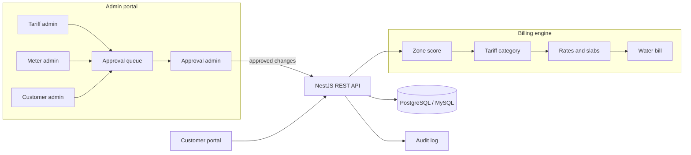

# Area-Based Water Tariff Platform

A web platform that helps a city water utility (WASA) in Bangladesh set **fairer water prices by area**. Instead of one flat rate for every household, each zone and area is scored using property-value indicators such as land rates and building tax rates, which act as a proxy for ability to pay. The score places it in a tariff category, and bills are then calculated from that category's rates.

Built for **WaterAid Bangladesh** to support Dhaka WASA and other utilities to move towards pro-poor, cost-reflective pricing.

> **Note:** Shared publicly with WaterAid Bangladesh's permission for portfolio and review purposes. No customer, billing or meter data is included. See [What is not in this repository](#what-is-not-in-this-repository).

---

## At a glance

| | |
|---|---|
| **Organisation** | WaterAid Bangladesh |
| **Technology partner** | ACME AI Ltd. |
| **Front end** | React 19, TypeScript, Vite, Tailwind CSS, shadcn/ui, TanStack Query, Leaflet maps, Recharts |
| **Back end** | NestJS 11, TypeORM, PostgreSQL or MySQL, Swagger API docs, bcrypt password hashing |
| **Languages** | Bangla and English across the interface |
| **Roles** | Super admin, tariff admin, meter admin, customer admin, approval admin, general info, and customers |

---

## Credits

Project led by **Ponuel Mollah Swadesh**, ICT and Digital Development Officer, WaterAid Bangladesh. He set the requirements with the utility and WaterAid's technical team, designed the role-based access model (who can view, edit, approve and administer data), reviewed and tested each release, and managed the delivery.

Software development by **ACME AI Ltd.**, WaterAid Bangladesh's technology partner, working jointly with WaterAid.

---

## Features

**Tariff design**
- Tariff categories with a movable base category, and multipliers above and below it
- Separate rules for piped supply and tubewell supply, with fixed rates for commercial and government users
- Volumetric slabs (price bands by amount used)
- Change the production cost or base rate and recalculate every category in one step

**Zone scoring**
- Build scoring rulesets from weighted parameters per area: land and home rates, land tax rate, and building tax rates by floor area
- Score each zone and area, then map the result to a tariff category
- Map view (Leaflet) showing zones, areas and which ruleset covers them

**Operations**
- Meter readers submit readings; meter admins review and approve them
- Customer and meter management, including CSV import
- Bills calculated automatically from consumption and the area's tariff category
- Customer portal with dashboard, billing history and feedback

**Governance**
- **Maker-checker approvals:** tariff and data changes go to an approval queue before they take effect
- **Full audit log** of who changed what, and when
- **Role-based access:** each role sees only its own menu, pages and API actions

---

## How it works



The billing engine uses a **strategy pattern** (`backend/src/water-bills/billing/`). Each supply type and customer category has its own billing strategy, so a new pricing rule can be added without changing the others.

---

## Project structure

```
Area-Based-Water-Tariff/
├── backend/                  NestJS API
│   └── src/
│       ├── tariff-category/  categories, multipliers, recalculation
│       ├── tariff-policy/    volumetric slabs and thresholds
│       ├── zone-scoring/     parameters, rulesets, zone scores
│       ├── water-bills/      billing strategies and bill generation
│       ├── consumption/      meter readings and approvals
│       ├── approval-requests/ maker-checker workflow
│       ├── audit-logs/       change history
│       └── users/, admins/, roles/, zones/, areas/, wards/, wasa/, meters/
└── frontend/                 React app
    ├── src/pages/            one page per role and task
    ├── src/components/       map layers, modals, tariff and scoring components
    └── public/data/          zone and area boundaries (GeoJSON)
```

---

## Running it

You need Node.js 20 or later and PostgreSQL (or MySQL).

```bash
# Back end
cd backend
cp .env.example .env          # set your database details
npm install
npm run start:dev             # API on http://localhost:3000, docs at /api-docs

# Front end (second terminal)
cd frontend
cp .env.example .env.local
npm install
npm run dev
```

Seed the default tariff categories with the seed endpoint described in [`backend/TARIFF_SYSTEM_DOCUMENTATION.md`](backend/TARIFF_SYSTEM_DOCUMENTATION.md).

Both parts build cleanly (`npm run build`). The back-end spec files are still the starter tests from project set-up and need proper mocks before they will pass.

---

## What is not in this repository

- Zone billing data, the mouza-wise WASA account data and any customer, meter or billing records
- Agreements, outcome reports and internal briefing documents
- Database passwords or deployment secrets. Settings come from `.env` files (see the `.env.example` files)
- Demo account passwords, which are now read from `VITE_DEMO_PASSWORD`

---

## What I learned

- **Pricing is a policy decision first.** The software has to make each assumption visible and adjustable (the base category, multipliers, slabs), because the utility and the regulator need to argue about numbers, not code.
- **Every change needs two people.** Tariffs affect thousands of households, so a maker-checker queue and a full audit log were requirements from day one, not extras.
- **Maps make the case.** Showing scores and categories on a map was what made the area-based approach easy for decision makers to understand.

---

## Licence

Copyright © 2025 to 2026 WaterAid Bangladesh. Developed jointly with ACME AI Ltd. Shared publicly with permission for portfolio and review purposes only. See [LICENSE.md](LICENSE.md).

## Maintainer

**Ponuel Mollah Swadesh**, ICT and Digital Development Officer, WaterAid Bangladesh
[swadeshmollah@gmail.com](mailto:swadeshmollah@gmail.com) · [GitHub](https://github.com/Swadesh1997)
